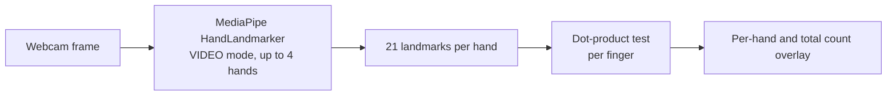

# Vector Hand Gesture Counter


Counts raised fingers on up to four hands in real time, and keeps counting correctly when the hands
are tilted, sideways or upside down. It uses MediaPipe's hand landmarker for the 21 keypoints and a
2D dot-product test in place of the usual "is the fingertip above the knuckle" check.

## The problem with comparing Y coordinates

The common tutorial approach says a finger is raised when its tip is higher in the image than its
knuckle:

```python
finger_up = tip.y < knuckle.y
```

That only holds while the hand points straight up. Turn the hand sideways and every tip sits at
about the same height as its knuckle. Turn it upside down and the answer inverts.

## The vector approach

"Raised" should be measured against the hand, not against the image. So the hand supplies its own
reference direction:

- **Palm vector** `P` runs from the wrist (landmark 0) to the middle-finger knuckle (landmark 9).
- **Finger vector** `F` runs from a finger's knuckle (MCP) to its tip.

The dot product `P · F = |P||F| cos θ` is positive when the angle between them is under 90°.

```
P · F > 0   finger points the same way as the palm   -> open
P · F ≤ 0   finger is folded back toward the wrist   -> closed
```

Rotating the hand rotates `P` and `F` together, so the angle between them, and therefore the
result, does not change. No trigonometry or handedness lookup is needed.

**Thumb.** The thumb opens sideways, so it is tested against the across-palm axis instead: the
vector from the pinky knuckle (17) to the index knuckle (5). That vector points toward the thumb
side on both left and right hands, front or back, so one rule covers every case:

```
(index_mcp − pinky_mcp) · (thumb_tip − thumb_ip) > 0   -> thumb out
```

**Aspect ratio.** MediaPipe returns coordinates normalised to 0–1 on each axis. On a 640×480 frame
one unit of x is not the same length as one unit of y, which skews angles, so vectors are scaled
back to pixels before the dot product.

## Pipeline



| File | Purpose |
|---|---|
| `hand_tracker.py` | Camera loop, model download, drawing |
| `finger_count.py` | The counting logic, no MediaPipe dependency |
| `test_finger_count.py` | Checks counts stay the same at 12 rotations, mirrored and not |

## Installation

```bash
git clone https://github.com/10yukine/vector-hand-gesture-counter.git
cd vector-hand-gesture-counter
python -m venv .venv
.venv\Scripts\activate        # macOS/Linux: source .venv/bin/activate
pip install -r requirements.txt
```

The hand landmarker model (about 8 MB) is downloaded on first run.

## Usage

```bash
python hand_tracker.py
```

| Option | Meaning |
|---|---|
| `--camera N` | Webcam index (default 0) |
| `--max-hands N` | Maximum hands to track (default 4) |
| `--model PATH` | Path to `hand_landmarker.task` |

Keys: `d` toggles the skeleton overlay, `q` quits.

```bash
python test_finger_count.py
```

## Limitations

- The test is 2D. A finger pointing straight at the camera is foreshortened and may read as closed.
- A thumb held flat against the side of the index finger sits near the decision boundary.

## Acknowledgements

Built together with **Gwen Alyzza M. Peregrino**.

## License

MIT
